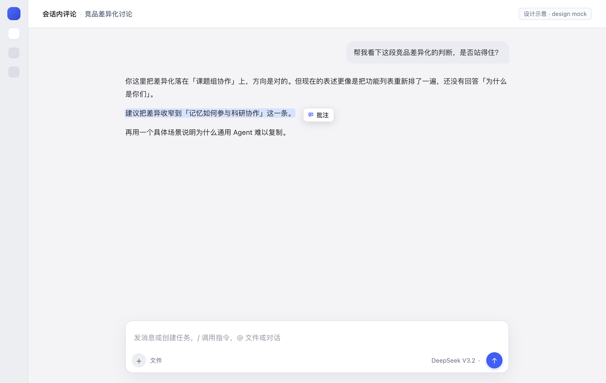
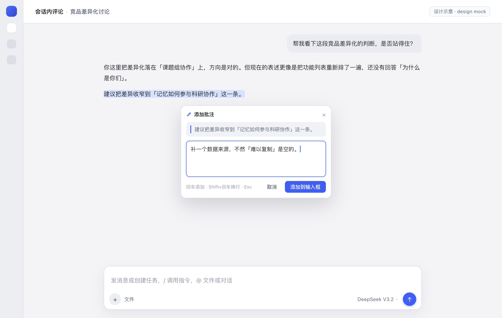
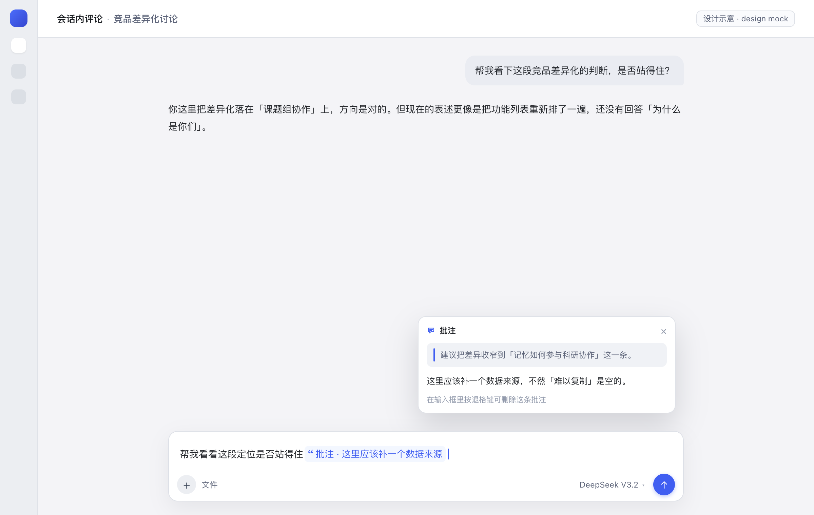
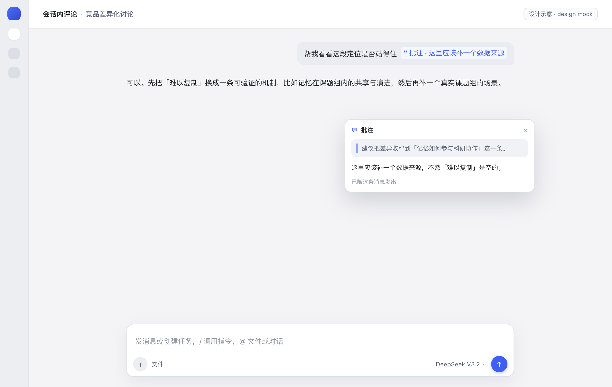
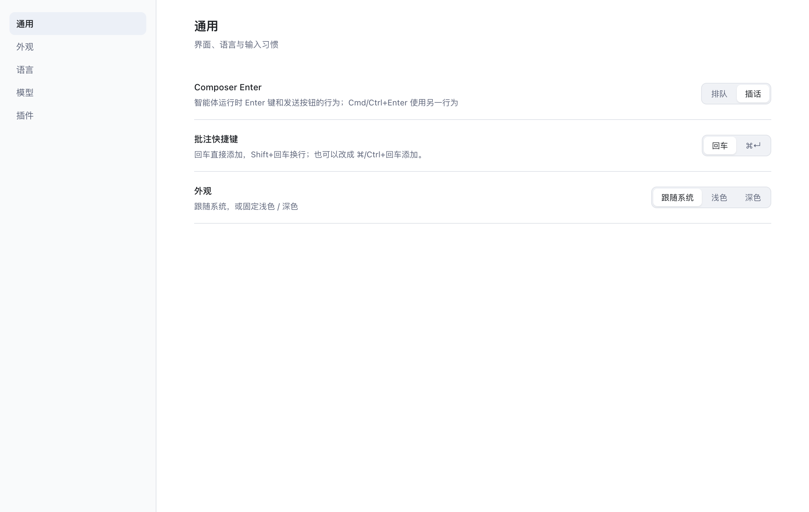

<p align="center">
  
</p>

<h1 align="center">Inline Comment</h1>

<p align="center">
  Selection-based comments for <b>DSH Web</b> conversations.<br>
  Select text, write a note, and it travels with your next message — as a chip in the composer and in the sent message.
</p>

<p align="center">
  <b>English</b> · <a href="README.zh-CN.md">简体中文</a>
</p>

<p align="center">
  <code>DSH Web client plugin</code> · <code>no runtime dependencies</code> · <code>zh / en</code>
</p>

---

## Preview

> These are design mocks that mirror the plugin's light-theme tokens, not screenshots of a live session.

<p align="center">
  
</p>
<p align="center"><sub><b>1 · Select.</b> Drag over any text in a conversation; the Annotate pill appears next to the selection when you release.</sub></p>

<p align="center">
  
</p>
<p align="center"><sub><b>2 · Annotate.</b> The quote is pinned in the card. Enter adds the note, Shift+Enter inserts a newline, Esc cancels.</sub></p>

<p align="center">
  
</p>
<p align="center"><sub><b>3 · Attach.</b> The note lands at the end of the composer as one atomic chip, with the caret after it. Hover or click to re-read the quote and note.</sub></p>

<p align="center">
  
</p>
<p align="center"><sub><b>4 · Send.</b> Sent messages keep the chip instead of spilling the quote block into the bubble. The model still receives the readable quote block.</sub></p>

<p align="center">
  
</p>
<p align="center"><sub><b>5 · Configure.</b> Settings → General → Comment shortcut switches between Enter and ⌘/Ctrl+Enter.</sub></p>

## Features

- **Select-to-comment** anywhere in a conversation — messages, replies, tool output.
- **One atomic chip** in the composer, appended at the end with the caret following it; backspace removes the whole note.
- **Preview on hover or click**, in the composer and after sending: quote and note side by side.
- **Chips survive sending.** A user-text rule turns the stored quote block back into the same capsule; the model still reads the block.
- **Enter to add, Shift+Enter for a newline** — switchable to ⌘/Ctrl+Enter.
- **Theme-aware, localized, zero-config.** Uses host theme tokens and the client locale service (zh / en).
- **No Host surface.** No service, tool, prompt, or session format change.

## Install

Requires a DSH profile with the Web client. From the DSH plugin manager:

```text
plugin_manager install_bundle
  target: /path/to/dsh-inline-comment
```

On this machine the checkout lives at `~/protocom/dsh-inline-comment`, so the target is
`/Users/miochan/protocom/dsh-inline-comment`.

Reload the Web window after installing; a full restart is only needed if the client bundle
revision does not refresh.

## Usage

1. Drag over text in a conversation. Release — the **Annotate** pill appears next to the selection.
2. Click it, write the note, and press **Enter** (or **⌘/Ctrl+Enter**). The note is appended to the
   composer as a reference chip.
3. Keep typing, or send. The model receives:

   ```text
   > the selected sentence (up to 320 characters)
   >
   > Annotation: why it needs to change
   ```

4. Hover the chip at any time to see the quote and the note. Backspace deletes the whole chip from
   the draft.

## Configuration

| Setting | Default | Where |
|---|---|---|
| Submit shortcut | `Enter` adds, `Shift+Enter` newlines | Settings → General → **Comment shortcut** |
| Alternative | `⌘/Ctrl+Enter` adds, `Enter` newlines | Same row |
| Quote limit | 320 characters | `MAX_QUOTE` in `client.js` |
| Note limit | 4000 characters | `MAX_COMMENT` in `client.js` |

The shortcut preference is stored in the browser at
`localStorage["dsh.inline-comment.submit-mode"]` (`enter` or `mod`) and applies immediately.

## How it works

| Surface | Extension point |
|---|---|
| Floating pill, compose card, preview card | `shell.overlay` |
| Composer bridge (`inputActions`, `useInput`) | `conversation.input.overlay` |
| Real reference chip | session-scope `slash/input-insert-reference` + an `inputTriggers` source |
| Sent-message chip | a `uiConversation.userText` rule + `conversation.user.text.node` |
| Shortcut row | `settings.general.item` |

A note is appended to the end of the draft by computing the detect offset of the draft end
(reference chips count as one character, command chips by `claim.token`), then inserted through the
same reference-chip path the `@file` picker uses. The chip's `ref` carries the quote and note as
base64url JSON, so the draft can be restored, previewed, and serialized after a reload. On send,
the plugin's serializer expands the chip into the quote block; on render, the user-text rule
recognizes that block and renders the capsule again.

## Compatibility

- Built against the DSH desktop client bundled with `0.2.1-rc.5`.
- Client-only: no Host plugin behavior, no session format, no tools.
- The chip uses the composer's reference-chip shell (`appearance: file`) with the file glyph hidden
  by a scoped CSS rule. If the host changes that DOM, the chip falls back to the file glyph; the
  feature keeps working.

## Development

The profile installs this directory as a link, so there is no build step:

```bash
# edit client.js, then reload the Web window
node --check client.js
```

If a change does not appear, restart DSH so the client bundle generation is rebuilt. The UI mock
source lives at `docs/mock/ui-mock.html`; open it with `?s=1`…`?s=5` at 1200×760 to regenerate the
preview images.

## Project layout

```text
dsh-inline-comment/
├── client.js            # UI, chip source, sent-message rule, settings row
├── index.js             # Host half (no-op)
├── cordis.patch.yml     # bundle insertion row
├── locale/              # plugin manager title + description (zh / en)
├── icon.svg
├── docs/
│   ├── preview-*.png    # README previews (design mocks)
│   └── mock/ui-mock.html
├── README.md
└── README.zh-CN.md
```

## Known limitations

- Sent-message recognition is text-level: any hand-written `> quote` + `> 批注：…` block renders as a
  chip. This is intentional and mirrors how `@file` mentions are recognized.
- Uninstalling the plugin while a draft still holds an annotation chip makes that draft unsendable
  (the serializer is gone). Delete the chip first.
- The quote is truncated to 320 characters and the note to 4000 before they enter the chip.
- The previews are design mocks; visual output follows the host theme.

## License

MIT © 2026 The Inline Comment Authors. See [LICENSE](LICENSE).
