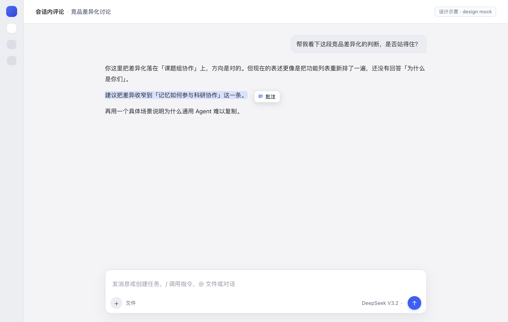
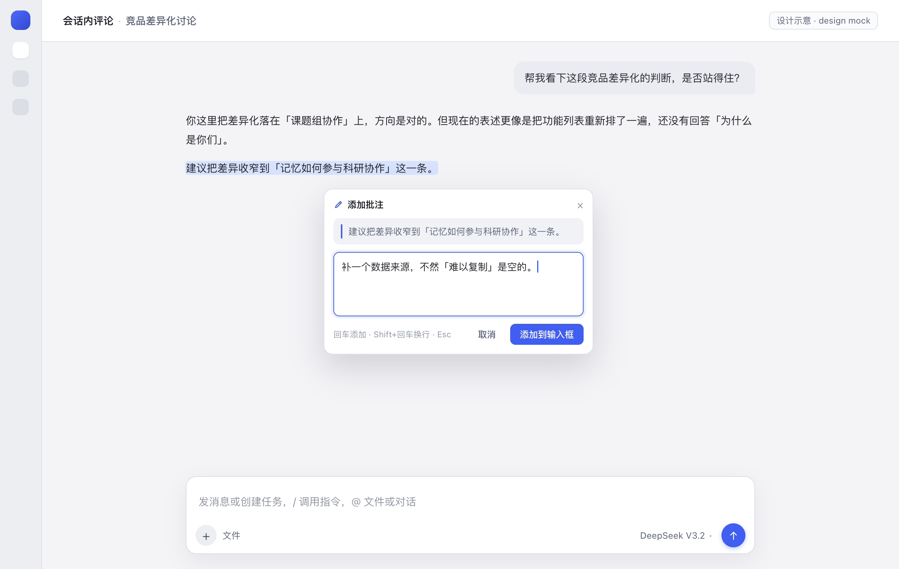
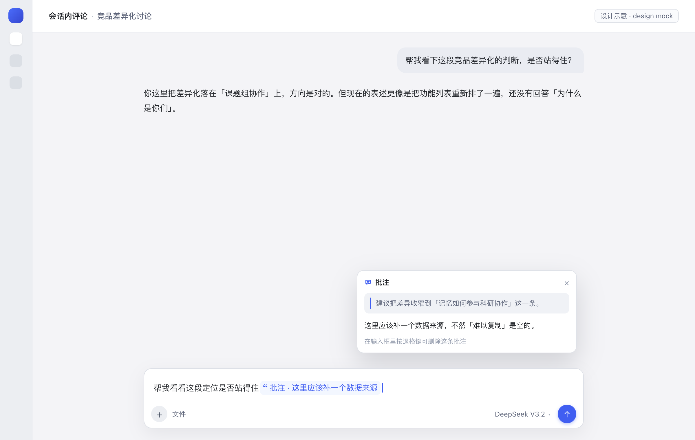
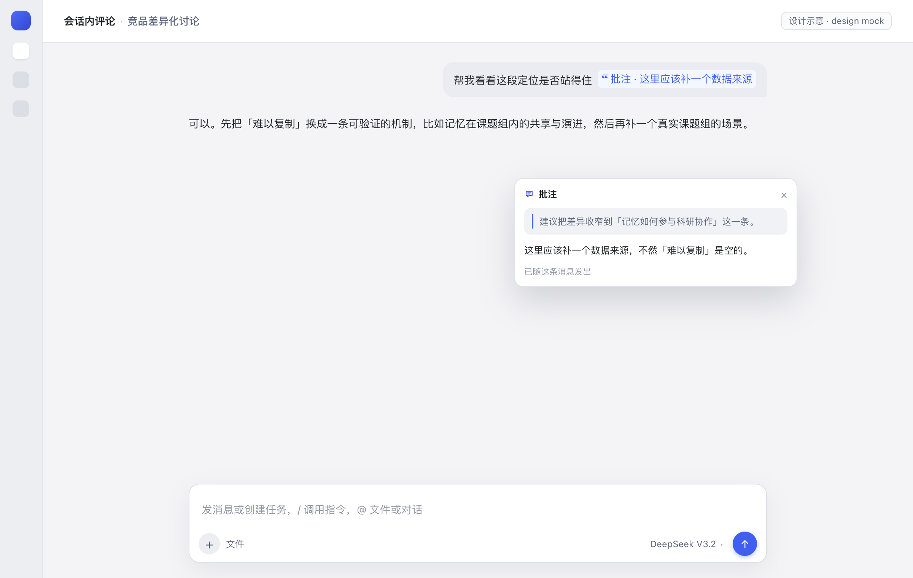
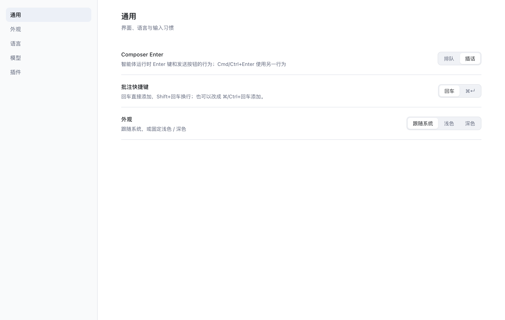

<p align="center">
  
</p>

<h1 align="center">会话内评论 · Inline Comment</h1>

<p align="center">
  DSH Web 会话里的选中批注。<br>
  选中一段文字，写下意见；它会以一枚胶囊跟着下一条消息进入输入框，并在发送后保留。
</p>

<p align="center">
  <a href="README.md">English</a> · <b>简体中文</b>
</p>

<p align="center">
  <code>DSH Web 客户端插件</code> · <code>无运行时依赖</code> · <code>中 / 英</code>
</p>

---

## 界面示意

> 下面是用插件同一套浅色主题变量做的设计稿，不是运行中会话的截图。

<p align="center">
  
</p>
<p align="center"><sub><b>1 · 选中。</b>在会话里拖选任意文字，松手后选区旁出现「批注」胶囊。</sub></p>

<p align="center">
  
</p>
<p align="center"><sub><b>2 · 批注。</b>卡片里固定显示原文；回车添加，Shift+回车换行，Esc 取消。</sub></p>

<p align="center">
  
</p>
<p align="center"><sub><b>3 · 附加。</b>批注追加到输入框末尾，成为一枚原子胶囊，光标落在其后；悬停或点击可回看原文和批注。</sub></p>

<p align="center">
  
</p>
<p align="center"><sub><b>4 · 发送。</b>消息里保留胶囊，而不是把整段引用铺进气泡；模型收到的仍是可读的引用块。</sub></p>

<p align="center">
  
</p>
<p align="center"><sub><b>5 · 设置。</b>设置 → 通用 →「批注快捷键」，在回车与 ⌘/Ctrl+回车之间切换。</sub></p>

## 特性

- **随处可批注**：用户消息、助手回复、工具输出里的正文都能选中。
- **一枚原子胶囊**：追加在输入框末尾，光标自动落在最后；退格一次整条删除。
- **悬停 / 点击回看**：输入框里和发送后都能看到原文与批注。
- **发送后仍是胶囊**：user-text rule 把存下来的引用块重新识别成胶囊；模型侧仍是引用块。
- **回车添加，Shift+回车换行**：可切换为 ⌘/Ctrl+回车添加。
- **跟随主题与语言**：只用宿主主题变量，文案走客户端 locale（中 / 英）。
- **不碰 Host**：没有 Host 服务、工具、提示词或会话格式改动。

## 安装

需要带 Web 客户端的 DSH profile。用插件管理器安装：

```text
plugin_manager install_bundle
  target: /path/to/dsh-inline-comment
```

`target` 指向这份代码的绝对路径即可，例如 `~/protocom/dsh-inline-comment`。

安装后刷新 Web 窗口；如果客户端 bundle 的 revision 没有更新，再重启 DSH。

## 使用

1. 在会话里拖选文字，松手后旁边出现「批注」胶囊。
2. 点开、写下意见，按 **回车**（或 **⌘/Ctrl+回车**）。批注会以引用胶囊追加到输入框末尾。
3. 继续输入或直接发送。模型收到的是：

   ```text
   > 选中的那句话（最多 320 字）
   >
   > 批注：这里为什么要改
   ```

4. 随时悬停胶囊回看原文和批注；在输入框里退格可整条删除。

## 配置

| 配置 | 默认 | 位置 |
|---|---|---|
| 提交快捷键 | 回车添加，Shift+回车换行 | 设置 → 通用 → **批注快捷键** |
| 备选 | ⌘/Ctrl+回车添加，回车换行 | 同一行 |
| 原文上限 | 320 字 | `client.js` 的 `MAX_QUOTE` |
| 批注上限 | 4000 字 | `client.js` 的 `MAX_COMMENT` |

快捷键偏好存在浏览器本地 `localStorage["dsh.inline-comment.submit-mode"]`
（`enter` 或 `mod`），切换即时生效。

## 实现方式

| 界面 | 扩展点 |
|---|---|
| 浮动胶囊、批注卡片、预览卡 | `shell.overlay` |
| 输入框桥（`inputActions`、`useInput`） | `conversation.input.overlay` |
| 真正的引用胶囊 | 会话 scope 的 `slash/input-insert-reference` + 一个 `inputTriggers` source |
| 发送后的胶囊 | `uiConversation.userText` rule + `conversation.user.text.node` |
| 快捷键设置行 | `settings.general.item` |

批注追加到草稿末尾：先按 detect 坐标算末尾偏移（引用胶囊按 1 个字符计、命令胶囊按
`claim.token` 计），再走和 `@file` 选文件相同的引用胶囊插入路径。胶囊的 `ref` 用
base64url JSON 带着原文和批注，所以刷新后草稿仍可预览、可发送。发送时由本插件的
source 把胶囊展开成引用块；渲染时 user-text rule 再把它识别回胶囊。

## 兼容性

- 基于 DSH 桌面客户端 `0.2.1-rc.5` 附带的客户端 API 编写。
- 纯客户端：没有 Host 插件行为、会话格式或工具改动。
- 胶囊复用 composer 的引用胶囊外壳（`appearance: file`），文件图标由只作用于该 source 的
  CSS 藏掉。宿主若改掉这层 DOM，会退回显示文件图标，功能不受影响。

## 开发

profile 以链接方式安装本目录，没有构建步骤：

```bash
# 改 client.js，然后刷新 Web 窗口
node --check client.js
```

改动没生效时重启 DSH，让客户端 bundle 重新生成。界面示意的源文件在
`docs/mock/ui-mock.html`，用 `?s=1`…`?s=5` 在 1200×760 下打开即可重新出图。

## 目录

```text
dsh-inline-comment/
├── client.js            # UI、胶囊 source、发送后 rule、设置行
├── index.js             # Host 半边（空实现）
├── cordis.patch.yml     # bundle 插入行
├── locale/              # 插件管理页标题与描述（中 / 英）
├── icon.svg
├── docs/
│   ├── preview-*.png    # README 示意图（设计稿）
│   └── mock/ui-mock.html
├── README.md
└── README.zh-CN.md
```

## 已知边界

- 发送后的识别是文本层面的：任何人手写「`> 引用` + `> 批注：…`」也会显示成胶囊。这是有意的，
  和 `@file` 的识别方式一致。
- 草稿里还有批注胶囊时卸载插件，会让这条草稿因为找不到序列化器而发不出去；先退格删掉。
- 原文进入胶囊前会截到 320 字，批注截到 4000 字。
- README 里的图是设计稿；实际界面跟随宿主主题。

## 许可证

MIT © 2026 The Inline Comment Authors，见 [LICENSE](LICENSE)。
